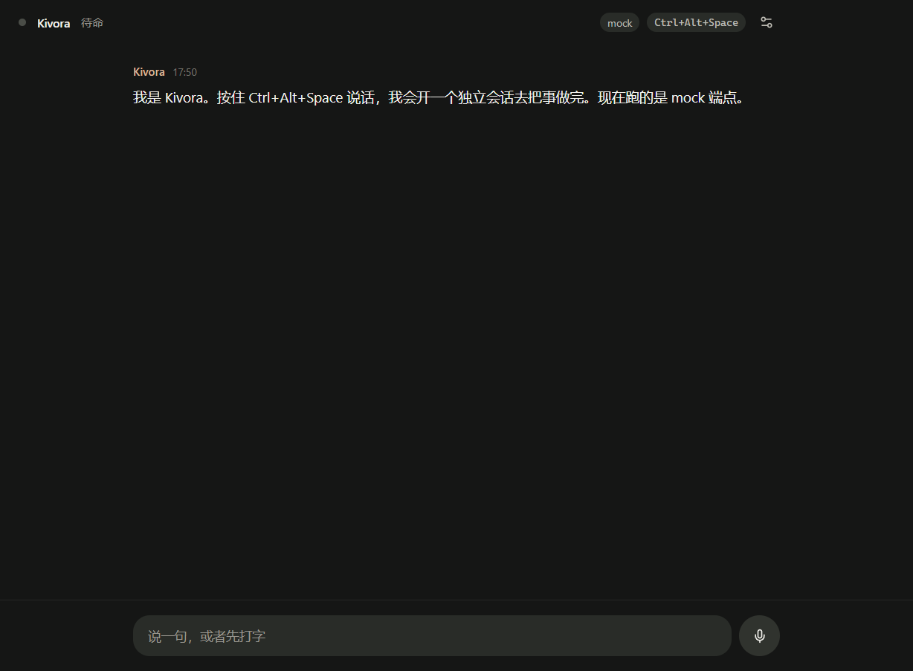

# Kivora

**Voice-first desktop agent for Windows, built on [Pi](https://github.com/earendil-works/pi).**

按住热键说一句话，Kivora 开一个独立会话，用 CUA 在你的电脑上把事做完，再用一句话告诉你结果。

> 状态：**D0（脚手架）**。当前只有窗口、SQLite、热键、消息时间线和 mock 调度器；ASR/TTS/CUA 在 D1–D7 接入。



---

## 现在能跑什么

```bash
pnpm install
pnpm dev        # 开发：Vite + Electron，热重载
pnpm build      # 产物：dist/（renderer）+ dist-electron/（main, preload）
pnpm start      # 跑构建产物
pnpm smoke      # 启动、截图到 artifacts/smoke.png、退出
pnpm typecheck  # tsc
```

启动后：

- `Ctrl+Alt+Space` 唤起（窗口内会亮"在听"）。
- 底部输入框回车，或点麦克风按钮（走 mock 转写），会把消息写进 SQLite 并拿到一句 mock 回复。
- 右上角齿轮打开设置：改热键、切 mock 模式。四段端点（ASR / TTS / brain / task）在配置里，D1 起接真实请求。

## 架构

```
Renderer (React 19 + Tailwind v4)
  └─ IPC（contextBridge，无 Node 权限）
Main (Electron 45 / Node 24)
  ├─ SQLite（node:sqlite，WAL）——唯一持久化入口
  ├─ store / config / (D3) VoiceAgent / (D4) SessionMgr
  └─ spawn: pi --mode rpc（D3 起）
```

- 渲染进程**不经手**任何持久化与密钥；只拿 IPC DTO。
- 存储用 Node 内置 `node:sqlite`，**没有原生模块**，不需要 electron-rebuild。
- 设计令牌复用栗记（Nuto）的「极简」语言，见 [docs/DESIGN-NOTES.md](docs/DESIGN-NOTES.md)。

## 设计稿

八块画板（时间线、运行中、设置抽屉、onboarding、会话历史、桌面悬浮、未处理队列、设置页）。索引与实现映射见 [docs/design-v1.md](docs/design-v1.md)，源文件 `docs/assets/kivora-design-v1.fig`。


## 路线

| 天 | 内容 |
|---|---|
| D0 ✅ | 仓库骨架、SQLite、热键、时间线、mock 调度 |
| D1 | 录音 + ASR（mock/真实可切）+ transcript 落库 |
| D2 | 设置页完整化、依赖检查 |
| D3 | VoiceAgent（pi-agent-core，14 工具） |
| D4 | SessionMgr + 状态投影 + 队列 |
| D5 | cua-driver 闸门（5 项过 4 项） |
| D6 | Playwright + 浏览器场景 |
| D7 | 审批总线 |
| D8 | 打包 + 首次运行引导 |
| D9 | 三场景 10 连跑 |
| D10 | demo + v0.1.0 |

## 许可

MIT。alpha 阶段，无沙箱，别在有重要文件的机器上长期跑。
