# Kivora 设计稿 v1

十四块画板。源文件 `docs/assets/kivora-design-v1.fig`，改稿在 OpenPencil 里改，重新导出即可（**只导 PNG，按 id 小范围导**）。

| # | 画板 | 说明 |
|---|---|---|
| 01 | 主时间线 | 默认态：消息、审批卡、任务条、输入区 |
| 02 | 运行中 | 旁白「我去搜」、任务条展开成过程日志、麦克风变 acorn |
| 03 | 设置抽屉 | 380 宽速设：热键 / 端点预览 / 语音开关 |
| 04 | Onboarding | 三步中的第 2 步：麦克风与热键，含试音条 |
| 05 | 会话历史 | 左列表右详情：事件流 + 对话摘要 + 操作 |
| 06 | 桌面悬浮 | 常驻胶囊 + 最近上下文（待处理 / 前台 / 选中 / 上次） |
| 07 | 未处理队列 | 插话 / 排队 / 执行中三态，可提前或取消 |
| 08 | 设置页面 | 左导航 + 四段端点卡片 + 测试/保存 |
| 09 | 悬浮权限 | 权限冒泡到调度器时的浮窗：语音 + GUI 双通道、倒计时 |
| 10 | 长文与折叠 | 长正文、思考块、工具输出、长审批列表的折叠规则 |
| 11 | 错误状态 | 端点错误横幅、ASR 失败行、任务失败条、失败卡片 |
| 12 | 模型仓库 | 模型列表 + 测试状态 + 功能模块绑定 |
| 13 | 模型详情 | Base URL / Model ID / Key、参数、自定义请求头 |
| 14 | 长文阅读器 | 正文"展开全文"之后的归宿：全文 + 来源 + 复制/引用 |

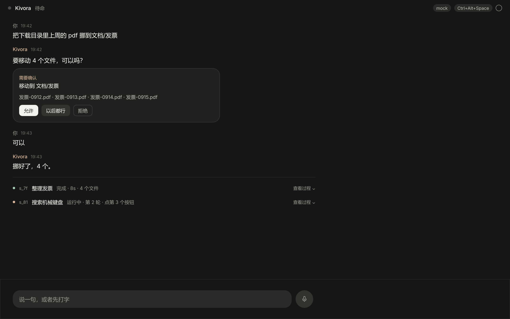
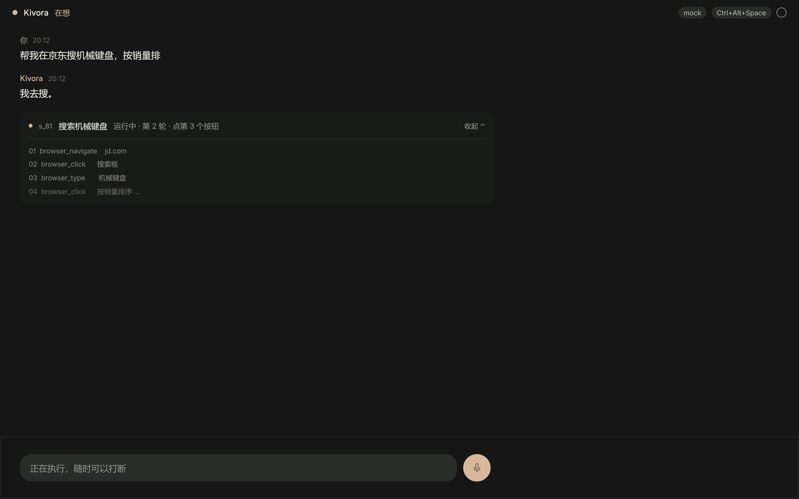
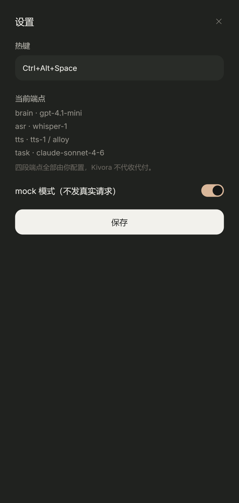
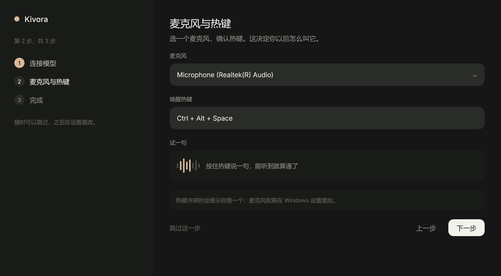
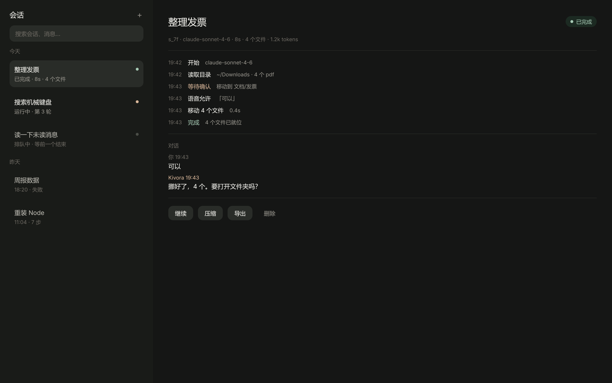
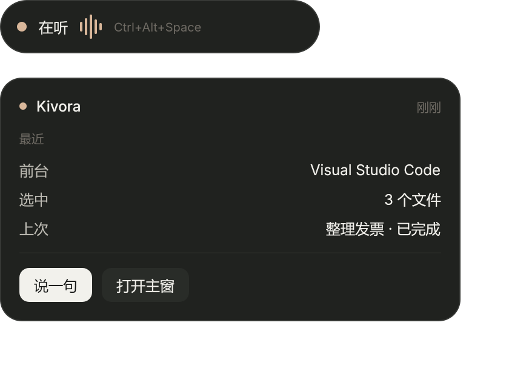
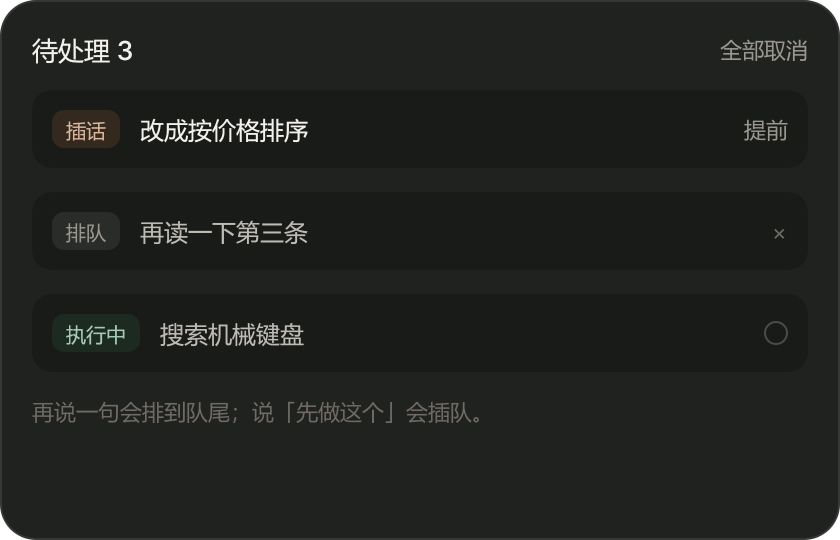
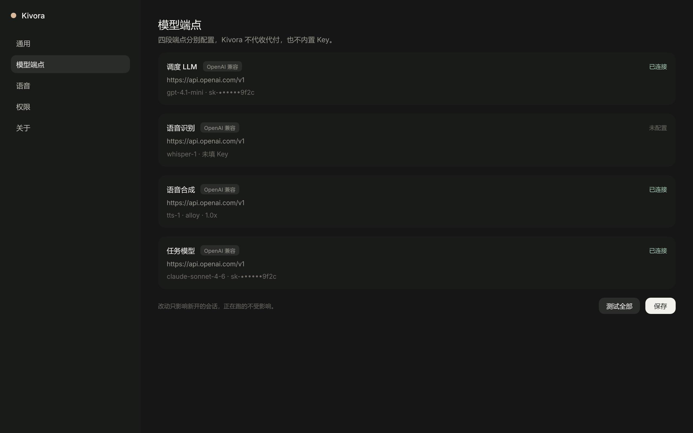
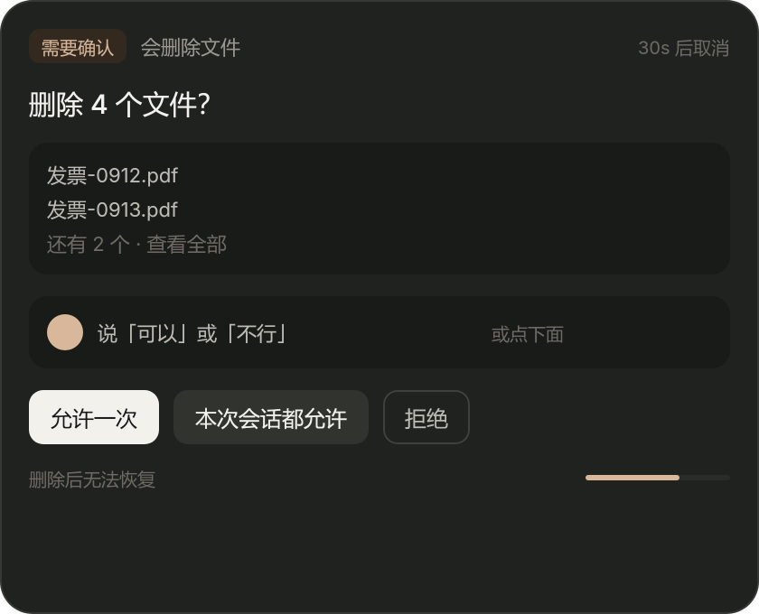
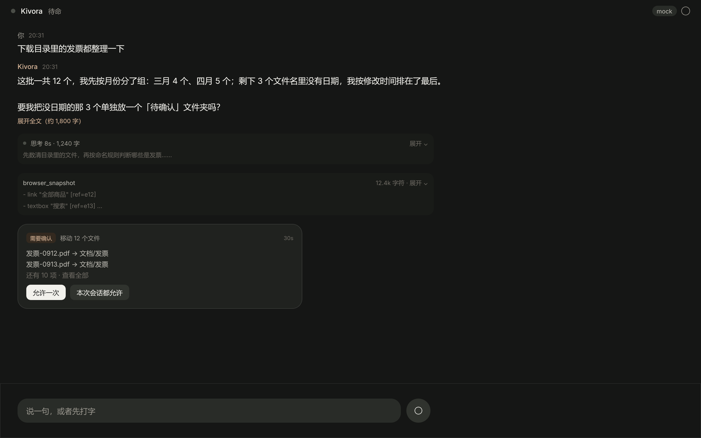
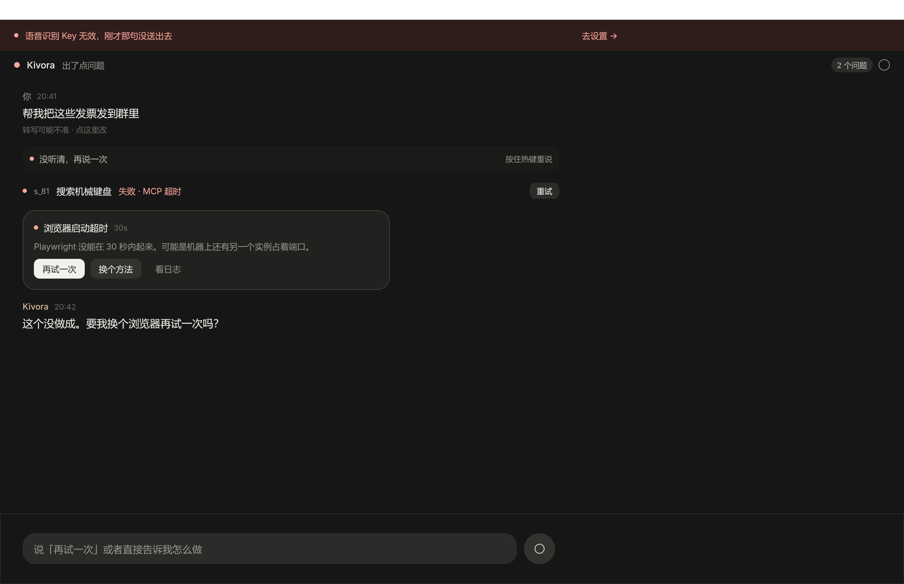
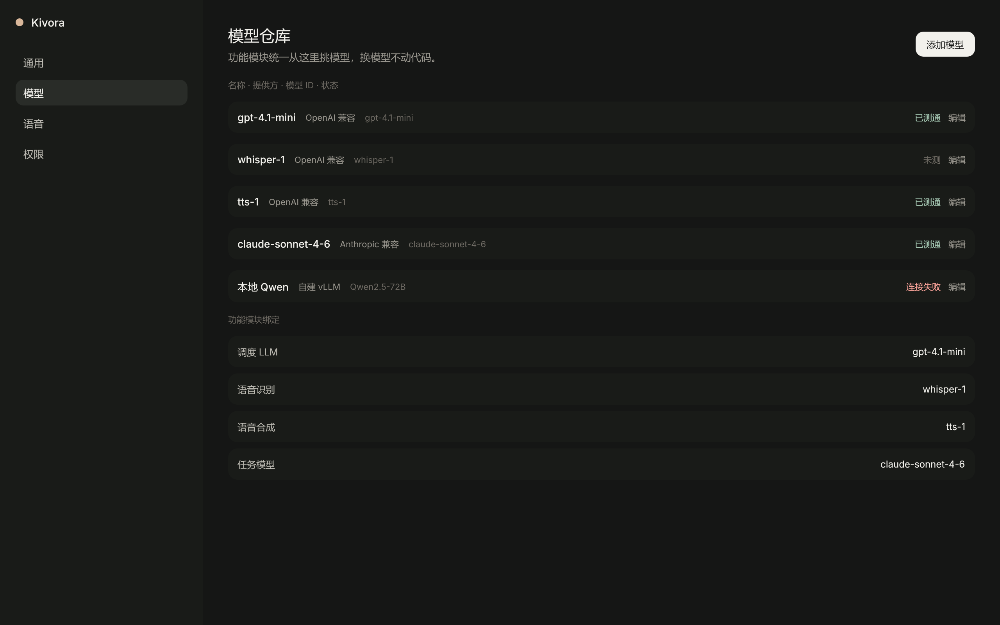
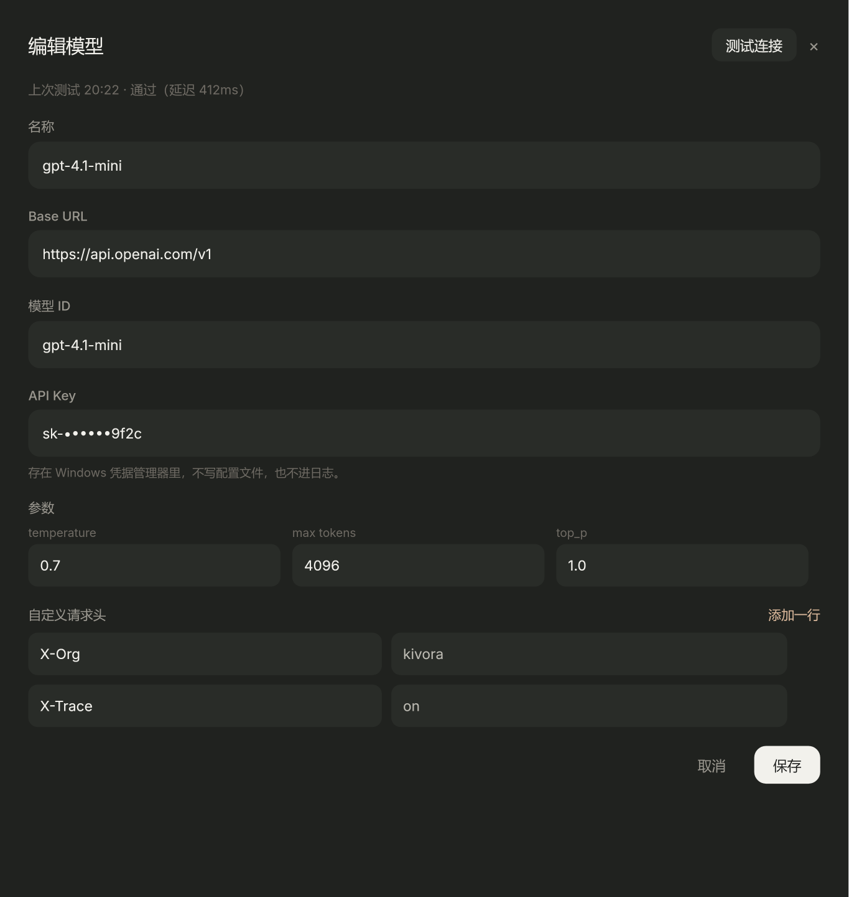
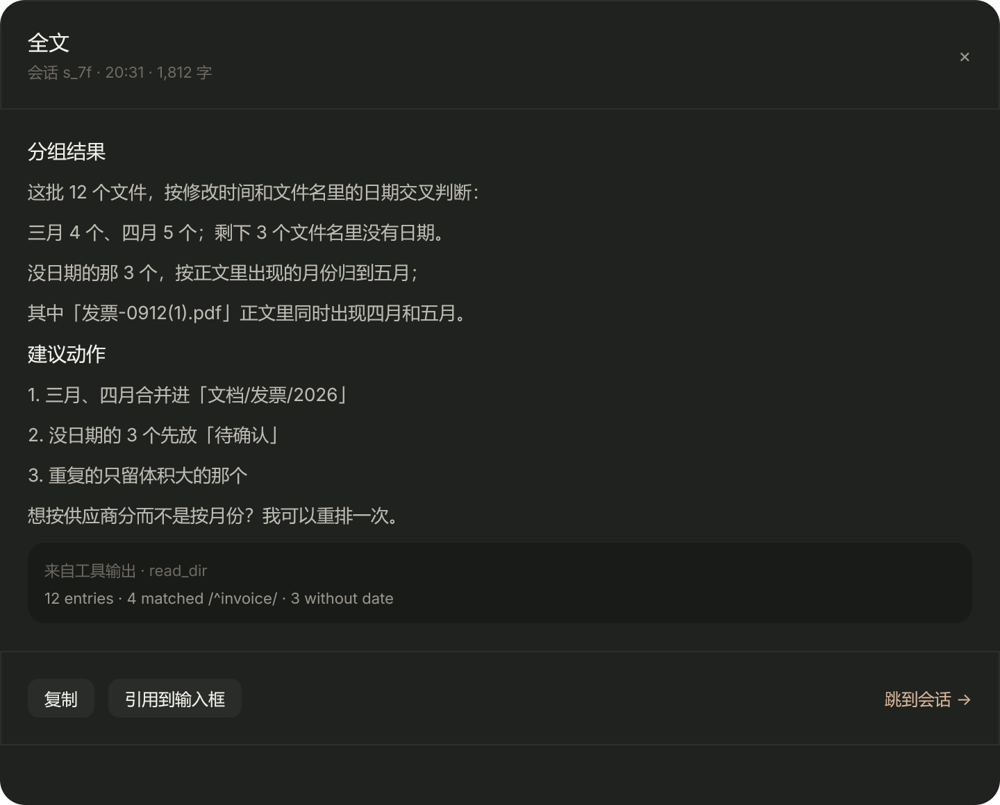

## 长文与折叠规则（10 / 14）

**两种省略号不能混用**：散文用尾部省略（结尾 `…`），路径 / URL / 模型 ID 用**中间省略**（保留头尾、中间 `…`），因为尾部才是人要找的东西。

| 界面 | 超长内容 | 策略 |
|---|---|---|
| 时间线正文 | 长段落 | 6 行 + 「展开全文（约 N 字）」→ 打开 14 阅读器 |
| 阅读器（14） | 极长文 | 独立面板：全文 + 来源 + 复制 / 引用 |
| 思考 | 长思考 | 默认折叠，一行摘要 + 「思考 8s · 1,240 字」 |
| 工具输出 | 大 JSON / 树 | 8 行或 2k 字符，首尾保留，中间省略 |
| 审批卡 / 浮窗（09） | 多文件、长路径 | 3 项 + 中间省略路径 + 「还有 N 项（共 M）」 |
| 任务条 | 长工具参数 | 单行省略，点开过程日志看全量 |
| 会话列表 / 悬浮卡 | 长标题 / 窗口名 | 单行尾部省略，hover 出全名 |
| 错误（11） | 堆栈、上游原文 | 人话摘要 + 「查看原始错误（12 行）」折叠 |
| 设置 / 模型（08/12/13） | 长 URL、model id | 中间省略 + 复制按钮 |
| 输入框 | 长转写 | 内部滚动、可编辑，不撑高窗口 |

规则：**展开永远收敛到"阅读器 / 日志 / 详情"三个落点**，不允许在时间线里无限拉高——时间线只长消息，不长内容。

## 错误状态规则（11）

四层，从外到内：

1. **横幅**：影响全局的配置错误（Key 无效、端点不可达）——顶部 44px，可点「去设置」。
2. **行内**：单次输入失败（没听清）——紧贴那条消息，给"重说"。
3. **任务条**：任务失败——红点 + 「失败 · 原因」+ 「重试」。
4. **卡片**：需要解释的失败——标题 + 原因 + 三个动作（再试/换方法/看日志）。

原则：错误必须给出**下一步动作**，不能只报"出错了"。

## 权限浮窗（09）

- 语音与 GUI 同权：说「可以 / 不行」，或点三个按钮。
- 三个选项固定语义：允许一次 / 本次会话都允许（写 grants）/ 拒绝。
- 30 秒倒计时，超时默认拒绝；危险级不提供"以后都行"。
- 浮窗出现在屏幕右下，不抢焦点，与主窗时间线里的审批卡同源。

## 实现映射

全部画板已在 v0.1 落地，对应关系：

| 画板 | 代码位置 |
|---|---|
| 01 / 02 / 10 / 11 | `src/renderer/pages/TimelinePage.tsx`、`components/timeline.tsx`（消息、折叠、审批卡、任务条、失败卡）、`components/composer.tsx`、`components/banner.tsx` |
| 03 设置抽屉 | 由 `pages/SettingsPage.tsx` 的「通用」页取代（热键 / 演练模式 / 端点在模型页） |
| 04 引导 | `pages/OnboardingPage.tsx` |
| 05 历史 | `pages/HistoryPage.tsx` |
| 06 悬浮 | `src/renderer/overlay/OverlayApp.tsx` + `overlay.html` |
| 07 队列 | `components/queue-panel.tsx` |
| 08 设置页 | `pages/SettingsPage.tsx`（通用 / 模型 / 语音 / 扩展 / 权限 / 关于） |
| 09 权限浮窗 | `src/renderer/permission/PermissionApp.tsx` + `permission.html`，数据来自 `src/main/dispatcher/approval-bus.ts` |
| 12 / 13 模型仓库 | `components/models-panel.tsx`、`components/model-editor.tsx` |
| （新增）扩展 | `SettingsPage.tsx` 的「扩展」页：CUA / 浏览器走 Pi 的 MCP 配置 |
| 14 阅读器 | `components/reader.tsx` |

窗口：`src/main/windows.ts`（主窗 / 悬浮 / 权限，三个入口）。样式令牌：`src/renderer/styles.css`。

## 落地时改过的地方

- **03 设置抽屉**并入设置页的「通用」，不再单独做抽屉——同一件事两个入口容易分叉。
- **05 历史**里去掉了「压缩」按钮：v0.1 没有接 Pi compaction，放一个点了没反应的按钮不如不放。
- **审批卡**在已解决后不再显示三个按钮，改成一句状态（已允许 / 已拒绝 / 超时未处理），避免"看着能点其实不能"。
- **悬浮卡的「前台」**改成「在跑」：v0.1 拿不到系统前台窗口，写一个假的进程名不如说真话。

